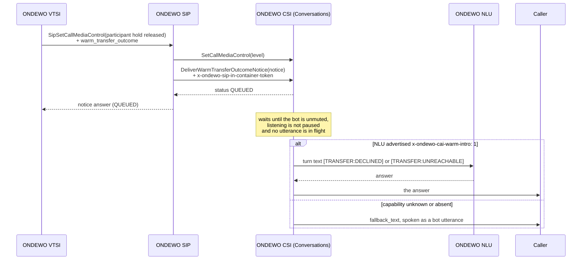

# Warm-transfer outcome notices in the ONDEWO CSI API

This guide describes how the speech-to-speech pipeline (ONDEWO CSI) learns that a warm transfer did NOT hand the
caller over, and how the bot then tells the caller. The generated reference of every message and field is
[index.md](index.md) (also `index.html`); this page explains how the pieces fit together. It covers ONDEWO CSI API
**5.9.0**.

The API surface is one RPC, `Conversations.DeliverWarmTransferOutcomeNotice`. It is an **internal** RPC: only ONDEWO
SIP in the same per-call container calls it. Applications do not call it; they ask for a warm transfer through
ONDEWO VTSI (`Calls.TransferCall` with a warm-transfer configuration), which runs the intro to the transfer target
and hands the outcome to ONDEWO SIP when it releases the bot.

While the intro runs, the bot is held muted and its listening is paused (the `participant` media-control hold, see
`SetCallMediaControl`). When the target accepts, the caller is handed over and no notice is sent. When the target
declines or cannot be reached, ONDEWO VTSI releases the hold and attaches a notice, and the bot tells the caller.

## Sequence



## `DeliverWarmTransferOutcomeNotice`

```protobuf
rpc DeliverWarmTransferOutcomeNotice (WarmTransferOutcomeNotice) returns (WarmTransferOutcomeNoticeResponse);

message WarmTransferOutcomeNotice {
    string request_id = 1;            // VTSI's transfer request id (or SIP's delegated request id); once per call
    WarmTransferOutcome outcome = 2;  // DECLINED | UNREACHABLE | DELEGATION_EXPIRED
    string intro_session = 3;         // NLU session of the intro; DECLINED only
    string callee_display_name = 4;   // the target's display name
    string cause = 5;                 // bounded token, for logs and telemetry
    string fallback_text = 6;         // the sentence spoken when the notice is not committed as a turn
}

message WarmTransferOutcomeNoticeResponse {
    WarmTransferOutcomeNoticeStatus status = 1;  // QUEUED | DUPLICATE | DISABLED | INVALID
}
```

### Fields

| Field | Semantics |
| --- | --- |
| `request_id` | ONDEWO VTSI's transfer request id; for `DELEGATION_EXPIRED`, ONDEWO SIP's delegated request id. 1 to 128 characters. The server takes each id at most once per call: a second notice with the same id answers `DUPLICATE`. |
| `outcome` | `WARM_TRANSFER_OUTCOME_DECLINED` (the target declined), `WARM_TRANSFER_OUTCOME_UNREACHABLE` (busy, no answer, no decision in time, or the intro could not run) or `WARM_TRANSFER_OUTCOME_DELEGATION_EXPIRED` (see [Delegation expired](#delegation-expired)). `WARM_TRANSFER_OUTCOME_UNSPECIFIED` answers `INVALID`. |
| `intro_session` | The NLU session name of the intro session, which holds the target's decline reason. Only with `DECLINED`, and empty when the target gave no reason. The NLU reads the reason from that session; the reason itself never travels in this message. |
| `callee_display_name` | The transfer target's display name, at most 128 characters. May be empty. |
| `cause` | A bounded lowercase token, at most 64 characters, e.g. `voicemail-suspected`, `target-hung-up`, `no-free-listener`. Logged; never spoken. |
| `fallback_text` | The sentence the bot speaks when it does not commit the notice as a turn, at most 1024 characters. ONDEWO VTSI renders it from its template with the target's display name and without any decline reason. Empty with `DELEGATION_EXPIRED`. |

### Authentication

Every request must carry ONDEWO SIP's in-container token in the `x-ondewo-sip-in-container-token` metadatum, as
`SetCallMediaControl` and `SetCallerDtmf` do. A missing or wrong token is answered with the gRPC status
**`UNAUTHENTICATED`** and nothing is queued (fail closed). A server built against a CSI API before 5.9.0 answers
**`UNIMPLEMENTED`**.

### Statuses (`WarmTransferOutcomeNoticeResponse.status`)

The checks run in this order:

| `status` | Meaning |
| --- | --- |
| `WARM_TRANSFER_OUTCOME_NOTICE_STATUS_DISABLED` | The server takes no notices (`CSI_WARM_TRANSFER_OUTCOME_ACTIVE` is not `true`). Nothing changed. |
| `WARM_TRANSFER_OUTCOME_NOTICE_STATUS_INVALID` | An empty or over-long `request_id`, an unspecified or unknown `outcome`, or a field over its bound. Nothing changed; do not retry it unchanged. |
| `WARM_TRANSFER_OUTCOME_NOTICE_STATUS_DUPLICATE` | A notice with this `request_id` was already taken on this call. Nothing changed. |
| `WARM_TRANSFER_OUTCOME_NOTICE_STATUS_QUEUED` | The notice was queued for the current call. |

`WARM_TRANSFER_OUTCOME_NOTICE_STATUS_UNSPECIFIED` (0) is never sent. ONDEWO SIP clears its pending notice on
`QUEUED` and `DUPLICATE`. On any other answer, or no answer, it keeps the notice pending and re-sends it by this RPC
when it resyncs csi; ONDEWO VTSI reports a notice that was not `QUEUED` or `DUPLICATE` as undelivered.

## How a queued notice is spoken

- **It waits for the floor.** The notice is spoken only once the bot is unmuted, its listening is not paused and no
  utterance is in flight, so the caller never hears it over the end of another answer.
- **A turn when the NLU can answer it.** If the NLU server advertised `x-ondewo-cai-warm-intro: 1` on the call, the
  notice is committed as a caller turn with the text `[TRANSFER:DECLINED]` or `[TRANSFER:UNREACHABLE]`, and the NLU
  answers it (with the decline reason from `intro_session`, when there is one).
- **`fallback_text` otherwise.** If the capability is unknown or absent, the server synthesises `fallback_text`
  itself as a bot utterance. It does the same when the floor stays busy past its commit timeout.
- **Either way it is an ordinary utterance**: the caller can interrupt it.
- **Only the end of the call drops it.** A queued notice is never dropped otherwise; `CALL_ENDED` forgets every
  notice of the call, because there is no caller left to tell.

### Delegation expired

A transfer the bot asked for can be handed to ONDEWO VTSI instead of being sent at once. If ONDEWO VTSI never
claims it in time, ONDEWO SIP sends no transfer and delivers a `DELEGATION_EXPIRED` notice instead. The server then
runs its failed-transfer action (`CSI_TRANSFER_FAILED_ACTION`) at a moment it chooses, never mid-utterance; it
speaks no `fallback_text`.

## Relation to `SetCallMediaControl`

The notice is NOT part of the media-control level: `CallMediaControlLevel` and `SetCallMediaControlResponse` carry
no notice field. ONDEWO SIP sends `DeliverWarmTransferOutcomeNotice` after the level push that releases the hold,
or on its own when the level did not change (for example when an operator hold keeps the bot muted). The RPC has no
generation, so a notice is never answered as stale; it is never announced on the control stream and never changes
the control status of `GetControlStream` / `SetControlStatus`.

## Security

- **No decline reason in this message.** The target's reason stays in the intro session and is read by the NLU
  only; `fallback_text` is rendered from a template without it.
- **No text is logged**: the server logs the `request_id`, the `outcome`, the `cause` and the status, never
  `fallback_text` or the display name.
- **Authentication** is the in-container token; nothing outside the container can deliver a notice.

## Limits

| Limit | Value |
| --- | --- |
| Notices per `request_id` and call | 1 (further ones answer `DUPLICATE`) |
| `request_id` | 1 to 128 characters |
| `callee_display_name` | at most 128 characters |
| `cause` | at most 64 characters |
| `fallback_text` | at most 1024 characters |

A relaunched server may speak a `fallback_text` a second time when ONDEWO SIP re-sends a notice whose `QUEUED`
answer was lost; this is accepted.

## See also

- [DTMF keys in the ONDEWO CSI API](dtmf.md): the other caller input ONDEWO SIP reports to the server.
